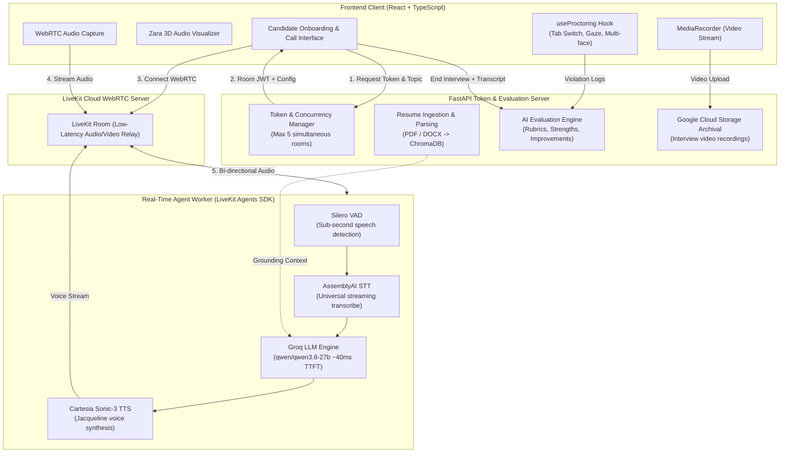

# TalentFlow AI — AI-Powered Video Interview Agent with Intelligent Proctoring

> An end-to-end, production-ready AI interview platform featuring real-time conversational voice interaction, automated resume grounding, intelligent multi-signal proctoring, and comprehensive candidate evaluation.

---

## 👥 Core Engineering Team

| Member | Role & Responsibilities | Branch |
|---|---|---|
| [**Saket Suman**](https://github.com/saketsumanai)<br>`@saketsumanai` | **Lead Full-Stack & AI Systems Architect**<br>• Core LiveKit WebRTC pipeline & Groq LLM integration<br>• Real-time voice agent orchestration (Zara) & Cartesia TTS<br>• Token capacity server & dual-LLM evaluation engine | [`member/saket`](https://github.com/saketsumanai/interview-agent/tree/member/saket) |
| [**Aashish Chandra**](https://github.com/Aashish-Chandr)<br>`@Aashish-Chandr` | **Computer Vision & Proctoring Engineer**<br>• Tab switch, focus loss & browser tamper detection hooks<br>• Face presence, multi-person & gaze deviation monitoring<br>• Proctoring integrity scoring & violation telemetry audit | [`member/aashish`](https://github.com/saketsumanai/interview-agent/tree/member/aashish) |
| [**Apurva Sinha**](https://github.com/apurvafx)<br>`@apurvafx` | **Backend & Knowledge Retrieval (RAG) Engineer**<br>• Multi-format resume extraction (PDF, DOCX) & text chunking<br>• ChromaDB vector embeddings & semantic retrieval pipeline<br>• Dynamic prompt synthesis & grounded question generation | [`member/apurva`](https://github.com/saketsumanai/interview-agent/tree/member/apurva) |
| [**Vishisht Sonker**](https://github.com/vishishtsonker)<br>`@vishishtsonker` | **Frontend UI/UX & Cloud Infrastructure Engineer**<br>• Modern dark-canvas React interface (Onboarding, Room, Reports)<br>• Web Audio API sound testing, orb visualizer & live transcripts<br>• Google Cloud Storage video archival & evaluation dashboard | [`member/vishist`](https://github.com/saketsumanai/interview-agent/tree/member/vishist) |

---

## 🏛️ System Architecture



---

## ⚡ Architecture Deep Dive

### 1. Ultra-Low Latency Conversational Voice Pipeline
- **Orchestration**: Built on LiveKit Agents framework with bi-directional WebSockets and WebRTC audio tracks.
- **Voice Activity Detection (VAD)**: Powered by **Silero VAD** with a `0.35s` silence detection threshold for immediate, human-like turn-taking.
- **Speech-to-Text (STT)**: **AssemblyAI Universal Streaming** with `format_turns=True` producing clean, punctuated transcripts.
- **LLM Engine**: **Groq Cloud** running `qwen/qwen3.8-27b`, achieving **sub-40ms Time-To-First-Token (TTFT)** without daily free-tier quota limits.
- **Text-to-Speech (TTS)**: **Cartesia Sonic-3** using the Jacqueline voice profile for warm, professional, articulate interview pacing.

### 2. Candidate Resume Grounding & Context Extraction
- On upload, resumes (`.pdf` or `.docx`) are parsed and indexed into **ChromaDB**.
- Raw resume text is injected into Zara's runtime prompt via `build_interview_prompt` to force questions grounded in the candidate's actual projects, languages, architectures, and metrics.

### 3. Intelligent Proctoring Engine
- **Browser State Tracking**: Instant detection of `visibilitychange` (tab switches, alt-tabs) and window blur events.
- **Multi-Signal Telemetry**: Tracks face count, prolonged gaze deviation, and outside device suspicion.
- **Integrity Score Deduction**: Real-time scoring starting at 100 with weighted penalties (5 points per tab switch, 4 per face anomaly) classified into *High Integrity*, *Medium Concern*, or *High Risk*.

### 4. Comprehensive Post-Interview Evaluation
- Aggregates the full dialogue transcript and proctoring telemetry.
- Evaluates across 4 core competencies:
  1. **Technical Competence** (Stack mastery, architecture trade-offs)
  2. **Problem Solving & Architecture** (Deconstruction of scale and edge cases)
  3. **Communication Clarity** (Articulation, direct answers)
  4. **Behavioral Competence** (STAR framework, team conflict resolution)
- Outputs concrete **"What to Improve"** habits and **"Where to Improve"** domain-specific gaps.

---

## 🌿 Git Branching & Contribution Workflow

To maintain clean code quality and avoid merge conflicts, **all team members work in their dedicated branches**:

### Member Branches:
- **Saket Suman**: `member/saket`
- **Aashish Chandra**: `member/aashish`
- **Apurva Sinha**: `member/apurva`
- **Vishist Sinha**: `member/vishist`

### Standard Workflow for Every Team Member:

#### 1. Clone the repository:
```bash
git clone https://github.com/saketsumanai/interview-agent.git
cd interview-agent
```

#### 2. Switch to your designated branch:
```bash
# Example for Aashish:
git checkout member/aashish

# Example for Apurva:
git checkout member/apurva

# Example for Vishist:
git checkout member/vishist

# Example for Saket:
git checkout member/saket
```

#### 3. Create feature branches off your member branch:
```bash
git checkout -b feature/aashish-gaze-detector
```

#### 4. Stage and commit your changes:
```bash
git add .
git commit -m "feat(proctoring): implement multi-face landmark detection"
```

#### 5. Push your branch to GitHub:
```bash
git push -u origin feature/aashish-gaze-detector
# or push directly to your member branch:
git push origin member/aashish
```

#### 6. Open a Pull Request (PR):
- Go to [GitHub Pull Requests](https://github.com/saketsumanai/interview-agent/pulls)
- Set base branch: `main` <- compare branch: `member/<your-name>`
- Request a review before merging into `main`.

---

## 🚀 Local Development Setup

### Prerequisites
- **Python 3.11+** with `uv` (`curl -LsSf https://astral.sh/uv/install.sh | sh`)
- **Node.js 18+** & `npm`
- **LiveKit Cloud account** ([cloud.livekit.io](https://cloud.livekit.io))
- API Keys: Groq, Cartesia, AssemblyAI, Google Gemini

### 1. Backend Setup
```bash
cd backend
cp .env.example .env.local
# Fill in your LIVEKIT, GROQ, CARTESIA, and ASSEMBLYAI keys in .env.local

# Run Token & Evaluation Server:
uv run token_server.py

# In a separate terminal, run LiveKit Agent Worker:
uv run agent.py dev
```

### 2. Frontend Setup
```bash
cd frontend
npm install
npm run dev
```
Open **`http://localhost:5173`** to begin interviewing!

---

## 🔒 Security & Privacy Policy
- All `.env.local` files, private API keys, candidate resumes, and local vector databases are explicitly ignored by `.gitignore` and **must never be committed**.
- Use `.env.example` as the canonical reference template for all required environment variables.
